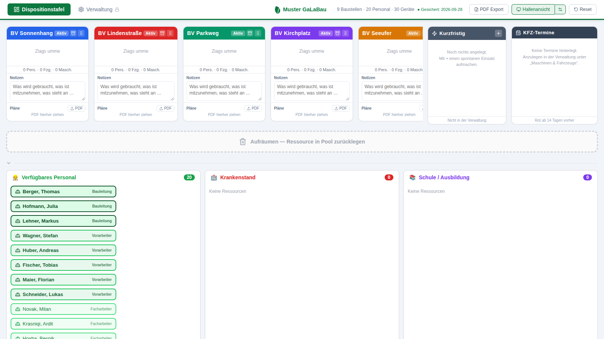

# Baustellendisposition

Dispositionstafel für Personal, Fuhrpark und Maschinenpark, mit Notizen und
abgelegten Plänen je Bauvorhaben, KFZ-Terminen und einer Hallenansicht für den
Monitor in der Halle.

> **Hintergrund:** Gebaut mit Claude Code für einen Garten- und Landschaftsbaubetrieb. Die App
> läuft auf einem normalen Büro-Rechner ohne Installation (siehe unten). Alle Namen, Baustellen
> und das Logo in diesem Repository sind **fiktive Demo-Daten**.
>
> **Stack:** React 19, TypeScript, Vite · Daten im Browser (localStorage / IndexedDB) ·
> kleiner PowerShell-Webserver für den Betrieb ohne Node.js · PDF-Export



---

## Auf einem weiteren Rechner starten

**Es muss nichts installiert werden.** Der Ordner `Baustellendisposition-Paket`
enthält alles Nötige.

1. Den Ordner auf den Rechner kopieren – Desktop, Dokumente, egal wohin.
2. Doppelklick auf **`Baustellendisposition starten.cmd`**.
3. Es öffnet sich ein schwarzes Fenster und daneben der Browser mit der Tafel.

Das schwarze Fenster **muss offen bleiben**, solange die Tafel läuft – darin
läuft der kleine Webserver. Zum Beenden das Fenster schließen.

| | |
|---|---|
| Tafel | http://localhost:5174/ |
| Hallenansicht | http://localhost:5174/#tv |

Ist der Port 5174 belegt, sucht das Programm selbst den nächsten freien und
schreibt die Adresse ins schwarze Fenster.

### Warum ein Webserver und nicht einfach die index.html?

Chrome sperrt die Browser-Datenbank auf `file://`-Adressen. Ohne Server ließen
sich also keine Pläne ablegen. Der mitgelieferte Server ist ein reines
PowerShell-Skript, das Windows von Haus aus ausführen kann; es hört
ausschließlich auf `127.0.0.1` und ist aus dem Netz nicht erreichbar.

### Falls Windows das Skript blockiert

Manche Firmenrechner verbieten PowerShell-Skripte. Dann erscheint eine Meldung
über die *Ausführungsrichtlinie*. Der Starter umgeht das bereits mit
`-ExecutionPolicy Bypass`; greift eine Gruppenrichtlinie, hilft nur die
IT-Abteilung – oder der Weg über Node.js weiter unten.

---

## Einzeldatei zum Verschicken

Wenn ZIP-Anhänge gesperrt sind, gibt es die Tafel auch als **eine einzige
HTML-Datei**, die sich per Doppelklick öffnet:

```
npm run einzeldatei
```

Ergebnis: `Baustellendisposition.html` (rund 1,1 MB), ohne Server, ohne
schwarzes Fenster.

**Was dabei fehlt:** aus einer Datei heraus sperrt Chrome die Browser-Datenbank,
in der die Pläne liegen. Der Dateibereich zeigt deshalb einen Hinweis statt
einer Ablagefläche. Notizen, Termine, Sortieren, Archivieren und die PIN
funktionieren normal, die laufen über den localStorage.

Sollte auch der localStorage gesperrt sein, erscheint oben ein rotes Band
**„Nichts wird gespeichert"** – dann hilft nur das vollständige Paket.

---

## Daten

Jeder Rechner hat seinen **eigenen** Datenbestand. Der Kollege startet also mit
den Beispieldaten.

**Daten übertragen:** auf dem Rechner mit den echten Daten unter
*Verwaltung → Verlauf* exportieren, die JSON-Datei hinüberkopieren, dort unter
*Verwaltung → Verlauf* importieren.

**Die abgelegten PDF-Pläne wandern dabei nicht mit.** Sie liegen in der
Browser-Datenbank des jeweiligen Rechners. Im Export steht nur der Eintrag; auf
dem anderen Rechner erscheint die Zeile ausgegraut mit dem Hinweis „nicht auf
diesem Gerät". Das ist die Grenze der jetzigen Bauweise – aufheben ließe sie
sich nur mit einer gemeinsamen Datenbank.

---

## Verwaltung

Die Verwaltung ist mit einer PIN gesperrt, damit niemand versehentlich die
Stammdaten verändert oder den Reset-Knopf drückt.

- Standard-PIN: **1234**, änderbar unten in der Verwaltung
- Die PIN gilt **pro Gerät** und muss auf jedem Rechner einmal gesetzt werden
- Nach dem Entsperren bleibt das Gerät offen, bis auf **Sperren** geklickt wird
- Auf allen nicht entsperrten Geräten ist nur die Dispositionstafel zu sehen

Das ist ein Schutz vor Versehen, keine Sicherheitsfunktion: der Datenbestand
liegt unverschlüsselt in den Browserdaten.

---

## Reset

Der Reset setzt alles auf den Auslieferungszustand zurück. Er verlangt die PIN
und eine Rückfrage, und danach erscheint 24 Stunden lang ein Hinweisband mit
**Reset rückgängig machen** – das übersteht auch einen Neustart des Browsers.

---

## Für die Weiterentwicklung

Braucht [Node.js](https://nodejs.org) (LTS).

```
npm install
npm run dev       # Entwicklungsserver mit Hot Reload
npm run build     # Baut nach dist/
npm run preview   # Liefert dist/ aus
npm run paket     # Baut und schnuert das Paket fuer andere Rechner
npm run lint
```

### Aufbau

| Pfad | Inhalt |
|---|---|
| `src/components/` | Tafel, Spalten, Karten, Pools, Hallenansicht |
| `src/components/resourceVisuals.tsx` | Symbol- und Farbkatalog für alle Ressourcen |
| `src/components/icons/` | Eigene SVGs für Pritsche, Planwagen, Anhänger, Bagger, Radlader |
| `src/store/useStore.ts` | Zustand-Store mit Speicherung in localStorage |
| `src/utils/normalize.ts` | Normalisierung aller von außen kommenden Datensätze |
| `src/utils/fileStore*.ts` | Ablage der Pläne in IndexedDB, hinter austauschbarem Interface |
| `src/utils/appointments.ts` | KFZ-Termine, Fälligkeit, Sortierung |
| `src/utils/adminLock.ts` | Gerätegebundene PIN-Sperre |
| `tools/serve.ps1` | Der mitgelieferte Webserver für Rechner ohne Node.js |

Gestaltet wird durchgängig mit Inline-Stilobjekten, kein Tailwind, keine
CSS-Module. Neuer Code sollte sich daran halten.
